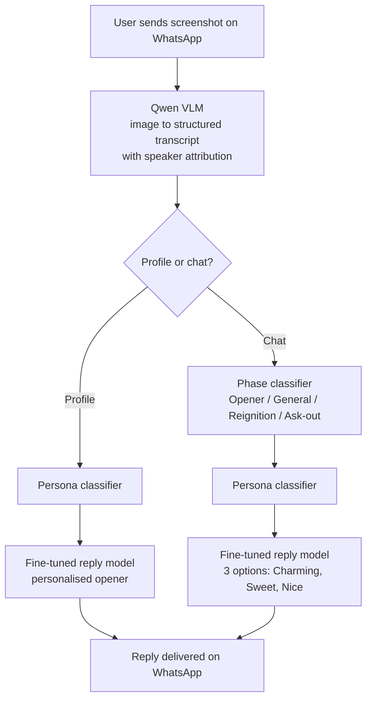

# CharmerX

**An India-first, WhatsApp-native AI dating assistant. 0 to 8,000 users in 5 months, 40% week-1 retention, ₹3L revenue. Wound down by choice in July 2025.**

I was the founder and PM. This repo is the product case study: what we bet on, what broke, what the numbers said, and what I would do differently.

---

## Try it

 &nbsp; 

1. Get a free Gemini API key at [aistudio.google.com/apikey](https://aistudio.google.com/apikey) (no card, about a minute).
2. Open the notebook above, choose **Runtime → Run all**, and paste your key when asked.
3. Upload a dating profile or chat screenshot and get the phase, a read on the situation, and 3 replies.

This is a 2026 rebuild of the core flow. It deliberately uses **one model call** where production used five, which was the main cost fix from the post-mortem below. To run it locally: `pip install -r requirements.txt` then `python charmerx.py`.

---

## My role

Founder and PM on a core team of 4 (technical co-founder, ML engineer, backend engineer), growing to ~10 with interns and contractors.

I owned:
- **Discovery:** 15 to 20 user interviews, ICP and segmentation, competitive and market research
- **Product decisions:** the WhatsApp-first bet, feature prioritisation, the move from RAG to fine-tuning, model selection
- **Monetisation:** paywall design and 3 rounds of pricing tests
- **Growth:** Instagram creative testing, channel experiments, influencer outreach
- **Metrics:** north star definition, weekly user feedback calls, the P&L

---

## The problem

On New Year's Eve 2024, a friend who is confident in person matched with someone on Hinge and immediately asked the room what to text back.

That became the hypothesis: many urban Indian men get matches but lose them in the first few messages. It is a format problem, not a social skills problem. The existing options were either US-built apps priced for US users or generic chatbots with no dating context, and none handled Hinglish.

**Primary user ("The Silent Matcher"):** 22 to 28, Tier 1 and Tier 2 cities, active on Hinge or Bumble, gets matches, stalls mid-conversation. Highest frequency of use and highest willingness to pay.

---

## How it works

Send a screenshot to the CharmerX WhatsApp number. Get back three replies (Charming, Sweet, Nice), tuned to where the conversation is and who you are talking to.

**Monetisation:** 5 free replies, then a Razorpay paywall. Winning plan: ₹99 for 100 replies/month, with a nudge at 90 and a soft block at 100.

---

## Architecture: three versions, each triggered by a specific failure

| Version | What changed | Why |
|---|---|---|
| **MVP** (Mar 2025) | WhatsApp Business API + GPT-4 Vision, profile openers only | Fastest way to test demand. 900 users in month 1. |
| **V1** (Apr to May) | Self-hosted Qwen VLM for parsing, phase classifier, RAG over 1,000 labelled chats | General vision models could not reliably tell which chat bubble was whose, and replies were generic. |
| **V2** (May to Jun) | Fine-tuned Claude replaced RAG + prompting | RAG was great when every step was right and mediocre when any step failed. Fine-tuning gave consistent quality. |

**Model choice was tested, not assumed:** two reviewers ranked GPT-4, Gemini and Claude outputs on 200 test conversations. Claude ranked highest on tone and became the base model.

**Trade-off accepted in V2:** better quality, but ~5 model calls per message. That decision is the main reason the unit economics below went negative.

---

## Key metrics

| Metric | Value | How measured |
|---|---|---|
| Users | 8,000 cumulative | Signups over 5 months |
| Growth | ~35% average WoW | Weeks 4 to 20; slow early, steep late |
| Week-1 retention | 40% | Users who uploaded a new screenshot 7 days later, with no reminder |
| Paying users | ~1,200 unique, ~1,500 transactions | Razorpay |
| Repurchase | ~20% of payers | Made a second payment |
| Revenue | ₹3L (~$3,600) | 5 months |
| **North star: IRL date rate** | **15% of paid users** | Self-reported on weekly calls with 20 to 30 paid users |
| Net P&L | –₹1.33L (69% of costs recovered) | Full 5-month P&L |

**Why date rate as the north star:** it is the outcome users actually want. A user who gets a date and churns is a success, not a failure.

**Caveats I'd flag in an interview:** retention is a behavioural proxy because WhatsApp gives no analytics, and the date rate is self-reported from a small sample. Instrumentation was the biggest gap (see below).

---

## Experiments (15+ over 3 months)

**Pricing**
- ₹50/week converted well but users did not value it. ₹600/month converted 4x worse.
- ₹99/month won on conversion. ₹199 had better margin but ~40% lower conversion. We chose growth, which turned out to be margin-negative.

**Acquisition**
- **Instagram micro-influencers won.** 20 reels, multivariate tested. Best creative: 30s, male presenter, "bro advice" tone, problem-led hook, direct WhatsApp link. ~70% of acquisition. The reels are on [@charmerx_official](https://www.instagram.com/charmerx_official/).
- **Adult ad network test failed.** ~500 clicks and 80% first-message rate, but only ~20 payers and ₹1,000+ CAC per payer. High intent did not mean high trust. Abandoned after one run.

**Use-case discovery**
- 50 users across 10 stratified cohorts (age, income, city tier, tech comfort). Mid-conversation rescue ranked #1 in every cohort and became the core of V1. A voice "mock date" feature tested well but was deprioritised on infra cost.

---

## Unit economics

At ₹99 for 100 replies, revenue per message was ~₹0.99 and cost per message was ~₹1.23. **Gross margin was roughly –24%.**

Two fixes were clear: merge the classifiers into one call (~35% cost cut), and move price to ₹150 to 200 once the habit was built. Neither was executed before wind-down.

---

## Why I wound it down

By June the product had real retention, the best model version yet and a visible path to break-even. Scaling it would have needed ₹50L to 1Cr in funding and a multi-year commitment to consumer dating, and my technical co-founder was moving on to another opportunity.

I chose to go deep on enterprise AI at HiLabs instead. It was a prioritisation decision, made with the data in hand, not a shutdown under pressure.

---

## What I would do differently

1. **Instrument from day one.** Without real analytics we relied on proxies and lost D7/D30 cohort data.
2. **Commit to a pricing migration before launching at ₹99.** Write down when and how price moves up.
3. **Ship a referral loop early.** Word of mouth was happening but was unstructured and unmeasured.
4. **Run a lightweight app alongside WhatsApp by month 2** for history, streaks and push notifications, to lift 30-day retention.
5. **Fix pipeline cost as soon as margin data came in,** not after.

---

## About this repo

The original production code and workflows are not public. What is here:

- `charmerx.py`: the 2026 demo rebuild (Gemini vision, one structured call, Gradio upload UI)
- `CharmerX_Demo.ipynb`: the same code, ready to run on Colab

Before this, I rebuilt a personal version on Telegram with n8n for orchestration, which is where this repo's original name came from.

*Utkarsh Srivastava, founder and PM, CharmerX (Jan to Jul 2025)*
