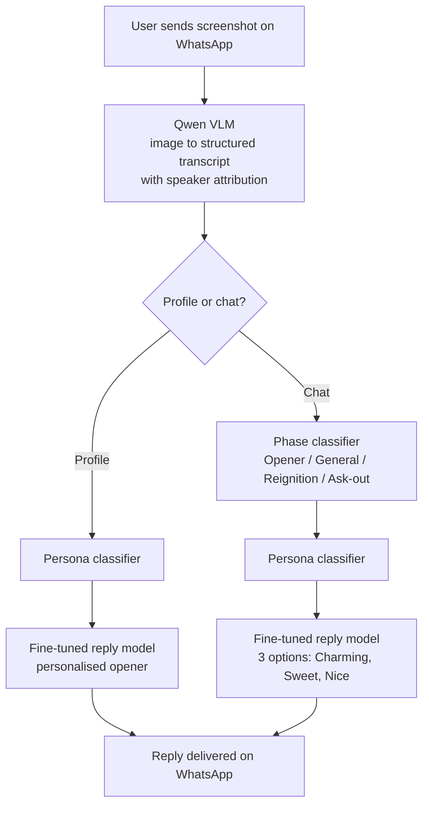

# CharmerX

**An India-first, WhatsApp-native AI dating assistant. Built 0 to 1 in 4 weeks, scaled to 8,000 users in 5 months, wound down deliberately in July 2025.**

I was the founder and PM. This repo is the product case study: the problem, the bets, the architecture, the experiments, the numbers, and what I would do differently.

---

## The problem

On New Year's Eve 2024, a friend who is confident in person matched with someone on Hinge and immediately asked the room what to text back. He was stuck at the text box, not at the bar.

That became the hypothesis: a large group of urban Indian men get matches but lose them in the first few messages. It is a format problem, not a social skills problem. Existing tools (Rizz, generic ChatGPT) were US-built, English-only, and priced at around ₹1,000/month. Indians made up a meaningful share of Rizz's paying users anyway, which told us the demand was real and underserved.

**Primary user ("The Silent Matcher"):** 22 to 28, Tier 1 and Tier 2 cities, active on Hinge or Bumble, gets matches, stalls mid-conversation. Highest frequency of use and highest willingness to pay.

---

## How it works

Send a screenshot to the CharmerX WhatsApp number. Get back three replies (Charming, Sweet, Nice), tuned to where the conversation is and who you are talking to.

**Monetisation:** 5 free replies, then a Razorpay paywall. Winning plan: ₹99 for 100 replies/month, with a nudge at 90 and a soft block at 100.

---

## Architecture: three versions, each triggered by a specific failure

| Version | What changed | Why |
|---|---|---|
| **MVP** (Mar 2025) | WhatsApp Business API + GPT-4 Vision, profile openers only | Fastest path to test demand. 900 users in month 1. |
| **V1** (Apr to May) | Self-hosted Qwen VLM for parsing, phase classifier, RAG over 1,000 labelled chats | General vision models could not tell which chat bubble was whose. Replies were generic. |
| **V2** (May to Jun) | Fine-tuned Claude replaced RAG + prompting | RAG was great when every step was right and mediocre when any step failed. Fine-tuning gave consistent quality. |

**Model selection was evidence-based:** two reviewers ranked GPT-4, Gemini and Claude outputs on 200 test conversations. Claude ranked highest on tone and was chosen as the base model.

---

## Key metrics

| Metric | Value | How measured |
|---|---|---|
| Users | 8,000 cumulative | Signups over 5 months |
| Growth | ~35% average WoW, peak ~45 to 50% | Weeks 4 to 20 |
| Week-1 retention | 40% | Users who uploaded a new screenshot 7 days later, unprompted |
| Paying users | ~1,200 unique, ~1,500 transactions | Razorpay |
| Repurchase | ~20 to 25% of payers | Second payment |
| Revenue | ₹3,00,000 (~$3,600) | 5 months |
| **North star: IRL date rate** | **15% of paid users** | Self-reported on weekly feedback calls |
| Net P&L | –₹1,33,000 (69% cost recovery) | Full 5-month P&L |

**Why date rate as the north star:** it is the outcome users actually want. A user who gets a date and churns is a success, not a failure.

---

## Experiments (15+ over 3 months)

**Pricing**
- ₹50/week converted well but users did not value it. ₹600/month converted 4x worse.
- ₹99/month won on conversion. ₹199 had better margin but ~40% lower conversion.

**Acquisition**
- **Instagram micro-influencers won.** 20 reels, multivariate tested. Best creative: 30s, male presenter, "bro advice" tone, problem-led hook, direct WhatsApp link. ~70% of acquisition.
- **Adult ad network test failed.** ~500 clicks and 80% first-message rate, but only ~20 payers and ₹1,000+ CAC. Intent is not the same as trust. Abandoned after one run.

**Use-case discovery**
- 50 users across 10 stratified cohorts (age, income, city tier, tech comfort). Mid-conversation rescue ranked #1 in every cohort and became the core of V1. A voice "mock date" feature tested well but was deprioritised on infra cost.

---

## Unit economics: the honest part

V2 made ~5 model calls per user message. At ₹99 for 100 replies, cost per message (~₹1.23) exceeded revenue per message (~₹0.99). **Gross margin was about –24%.**

Two clear fixes existed: merge the classifiers into one call (~35% cost cut), and move price to ₹150 to 200 once habit was built. Neither was executed before wind-down.

---

## Why I wound it down

By June the product was working at experiment stage: real retention, growing revenue, the best model version yet, and a visible path to break-even. Scaling would have needed ₹50L to 1Cr in funding, a multi-year commitment to consumer dating, and a technical co-founder, who had just accepted an offer to build a similar product at FRND.

I chose to go deep on enterprise AI at HiLabs instead. It was a prioritisation decision made with full information, not a shutdown under pressure.

---

## What I would do differently

1. **Instrument from day one.** WhatsApp gives no retention analytics, so we relied on proxies and lost D7/D30 cohort data.
2. **Commit to a pricing migration before launching at ₹99.** Write down when and how price moves up.
3. **Ship a referral loop early.** Word of mouth was happening but was unstructured and unmeasured.
4. **Run a lightweight app alongside WhatsApp by month 2** for history, streaks and push, to lift 30-day retention.
5. **Optimise the pipeline for cost as soon as margin data came in,** not after.

---

*Built and run by Utkarsh Srivastava, Jan to Jul 2025. Code and workflows from the original build are not public; this repo documents the product.*
